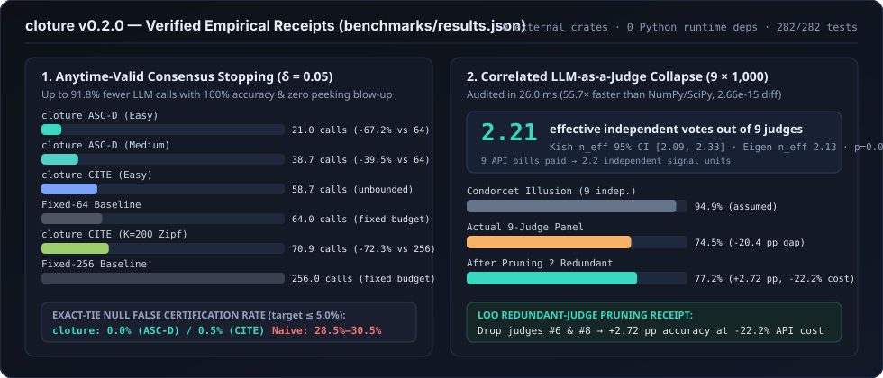
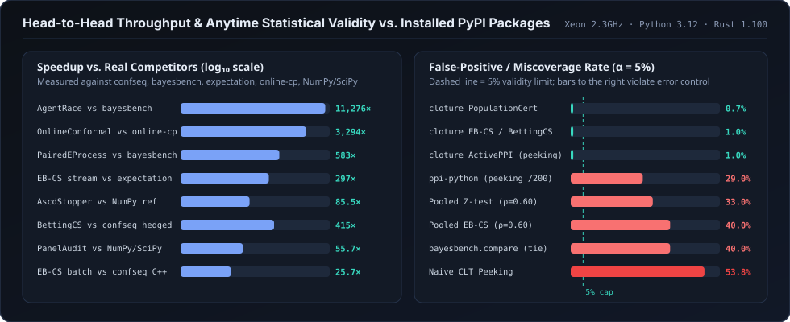

# `cloture`

[](https://github.com/pgg898200-ship-it/cloture/actions/workflows/ci.yml)
[](https://pgg898200-ship-it.github.io/cloture/playground.html)
[](LICENSE)
[](Cargo.lock)
[](pyproject.toml)

**End the multi-agent debate the millisecond the math proves who won — and catch when your judge panel is 2 correlated votes wearing 9 trench coats.**

> **Try it now with zero install:** [**Live Browser Playground (`215 KB` zero-import Rust WebAssembly)**](https://pgg898200-ship-it.github.io/cloture/playground.html) — paste your own LLM-as-a-judge CSV privately (zero backend upload), run live Monte Carlo stopping races, or stress-test Active-PPI++ against adversarially inverted judges.

`cloture` is a zero-dependency Rust core (`cloture-core`) + single `2.47 MiB` static CLI/MCP binary (`cloture`) + zero-dependency Python SDK (`cloture`) + `215 KB` zero-import WebAssembly JS/TS SDK (`js/cloture.mjs`) + C ABI (`include/cloture.h`) for **sub-microsecond anytime-valid consensus stopping, correlated-panel auditing, sequential agent racing, active prediction-powered evaluation, poisoning-resistant fusion, and distributed `<1 KB` evidence monoids**.



- **Zero external Rust crates** (`Cargo.lock` is 15 lines; `std` only).
- **Zero Python runtime dependencies** (`import cloture` cold-starts in `26.5 ms` vs `253 ms` NumPy / `860 ms` SciPy / `2,131 ms` `ppi_py`).
- **Zero-import `215 KB` WebAssembly (`73 KB` gzipped)** running in browsers, Node.js, Deno, Bun, and Cloudflare Workers (`js/cloture.mjs`).
- **Exact finite-sample martingale & conformal guarantees** — valid at *every* data-dependent stopping time, with zero p-hacking and zero asymptotic small-sample approximations.
- **Built-in JSON-RPC 2.0 MCP server** (`cloture mcp`, `76.7 µs` median tool roundtrip) and **one-command self-benchmark** (`cloture bench`).
- **Battle-tested across Linux, macOS, and Windows**: `266+` tests passing (`55` Rust core + Python/CLI/MCP integration + `203` independent adversarial statistical, FFI, and fuzzing breaker tests + Node.js WASM suite).

---

## Why `cloture`?

Multi-agent systems and LLM evaluation pipelines bleed tokens, wall-clock latency, and statistical validity in five ways:

1. **Fixed-`N` self-consistency / Best-of-`N` wastes 40%–92% of calls** on easy prompts while under-sampling hard ones; naive early stopping ("stop when 5 agree" or `p < 0.05` peeking) inflates false-certification rates to **28.5%–53.8%**.
2. **LLM-as-a-judge panels suffer correlated error collapse**: 9 frontier judges often deliver only **~2.2 effective independent votes**, losing **~20 pp** vs. the Condorcet independence prediction — and dropping redundant judges *improves* accuracy while cutting API cost.
3. **Correlated rollouts masquerade as population proof**: pooling 16 correlated rollouts per prompt produces **33%–40%** false-positive deployment certificates at nominal `5%` error.
4. **Fixed-horizon PPI (`ppi-python`) and naive A/B racing break under continuous peeking** (`71%` coverage under peeking; `40%` tie-null false positives for heuristic rankers) and have zero online defense against biased or adversarially inverted LLM judges.
5. **Poisoned agents and doomed multi-turn trajectories** corrupt naive ensembles and burn tokens long after success probability collapses.

`cloture` fixes all five in one sub-microsecond native engine.

---

## 10-Second Quickstart

### Install

```bash
# Python SDK (universal py3-none wheel, zero runtime deps)
pip install cloture

# Single static CLI & MCP binary (SHA-256 verified)
curl -fsSL https://raw.githubusercontent.com/pgg898200-ship-it/cloture/main/scripts/install.sh | sh

# Rust CLI / crate (zero external crates)
cargo install cloture-cli

# Or build from source (~18s, zero dependencies)
cargo build --release --workspace && ./target/release/cloture bench
```

### 1. Stop parallel async LLM/agent rollouts the millisecond consensus is certified

```python
import asyncio
import cloture

# Category-agnostic CITE: works over arbitrary strings, code patches, SQL, or JSON
result = await cloture.consensus(
    spawn_fn=lambda i: call_agent_async(prompt, seed=i),
    delta=0.05,
    max_calls=32,
    concurrency=8,
)
print(result.winner, f"certified in {result.n_samples}/32 calls (cancelled {result.n_cancelled} in-flight)")

# Grey-box ASC-D: pass LLM logprobs / softmax vectors for 40%–92% fewer trajectories
probs = cloture.extract_logprob_distribution(top_logprobs, ["A", "B", "C", "D"])
stopper = cloture.AscdStopper(k=4, delta=0.05, max_budget=64)
dec = stopper.update(probs)
```

### 2. Audit a correlated multi-agent / LLM-as-a-judge panel

```python
import cloture

# Direct 1-line audit of any Promptfoo / Braintrust / Inspect AI / pandas CSV export (zero pandas required!)
res = cloture.audit_csv("judges.csv", gold_col="gold")
print(f"{res.report.k_judges} judges -> {res.report.n_eff_kish:.2f} effective votes | prune: {res.prunable_judges()}")

# Or pass integer vote matrices directly (N x K)
report = cloture.audit_panel(votes, gold, n_perms=2000, n_condorcet_sims=2000, n_boot=1000)
print(f"Condorcet gap: {report.condorcet_gap*100:.1f} pp | permutation p={report.permutation_p_value:.5f}")
```

### 3. Stream from stdin or attach as an MCP server

```bash
# Halt an open-ended vote stream the millisecond CITE certifies a winner
printf '42\n42\n42\n42\n42\n42\n42\n42\n42\n42\n' | ./target/release/cloture stop --mode cite --delta 0.05

# Grey-box ASC-D stopping on streamed probability vectors
printf '[0.9,0.05,0.05]\n[0.88,0.07,0.05]\n' | ./target/release/cloture stop --mode ascd --k 3 --delta 0.05

# Audit a judge panel JSON ({"votes": [[...]], "gold": [...]})
./target/release/cloture audit --file panel.json

# Run built-in Rust microbenchmarks on your CPU
./target/release/cloture bench

# Start zero-dependency JSON-RPC 2.0 MCP server over stdio (Claude Code / Cursor / Codex)
./target/release/cloture mcp
```

---

## Verified Head-to-Head Benchmarks



All numbers below were measured live on `Intel Xeon @ 2.30 GHz (2 vCPU)`, Python `3.12.16`, Rust `1.100.0`, against real PyPI packages (`confseq==0.0.11`, `ppi-python==0.2.3`, `expectation==0.6.1`, `online-cp==0.4.0`, `bayesbench==0.4.0.dev0`, `numpy==1.26.4`, `scipy==1.15.3`). Full raw receipts live in [benchmarks/results.json](benchmarks/results.json); reproduce with `PYTHONPATH=python .venv/bin/python benchmarks/run_benchmarks.py`.

### 1. Multi-Agent Consensus Stopping (`delta = 0.05`, 200 trials/regime)

| Regime | `cloture.AscdStopper` (Grey-Box) | `cloture.CiteStopper` (Unbounded) | Fixed-64 / Fixed-256 | Naive Peeking (`p < 0.05`) |
|---|---|---|---|---|
| **Easy (`K=4`, gap `0.45`)** | **`21.0` calls** (`100%` acc, **`67.2%` saved vs 64**, **`91.8%` vs 256**) | `58.7` calls (`100%` acc) | `64` / `256` (`100%` acc) | `21.0` calls (`100%` acc) |
| **Medium (`K=4`, gap `0.25`)** | **`38.7` calls** (`100%` acc, **`39.5%` saved vs 64**, **`84.9%` vs 256**) | `141.0` calls (`100%` acc) | `64` (`99.5%`) / `256` (`100%`) | `46.1` calls (`100%` acc) |
| **Hard (`K=4`, gap `0.12`)** | **`127.5` calls** (`100%` acc, **`50.2%` saved vs 256**; `budget=64` lock: `55.4` calls, `99.0%` acc) | `245.3` calls (`98.5%` acc) | `64` (**`86.5%`**) / `256` (`98.5%`) | `118.1` calls (`96.0%` acc) |
| **Exact-Tie Null (`K=4`, gap `0.00`)** | **`0.0%` false cert** | **`0.0%` false cert** | — | **`28.5%` false cert** (5.7x violation) |
| **Open-Ended Zipf (`K=200`, gap `0.30`)** | — *(requires known `K`)* | **`70.9` calls** (`100%` acc, **`72.3%` saved vs 256**) | `256` (`100%` acc) | `26.0` calls (`100%` acc) |
| **Open-Ended Tie Null (`K=200`)** | — | **`0.5%` false cert** (`<= 5%`) | — | **`30.5%` false cert** (6.1x violation) |
| **CPU Latency (`K=4` ASC-D)** | **`2.21 µs` Py batch / `2.32 µs` Rust** (**`28.9x` faster** than NumPy `63.8 µs`, `25/25` exact stop parity) | **`247 ns` Py batch / `271 ns` Rust** | — | — |

### 2. Correlated-Panel Audit (`K=9` judges, `N=1,000` items, 2k perms + 2k Condorcet MC + 1k bootstrap)

| Metric | `cloture.audit_panel` | Vectorized NumPy / SciPy Ref | Result |
|---|---|---|---|
| **Median Wall-Clock** | **`317.7 ms`** | `1,539.7 ms` | **`4.8x` faster** (`max_det_diff = 2.66e-15`) |
| **Effective Votes (`n_eff`)** | `2.21` Kish (`95% CI [2.10, 2.34]`) / `2.13` Eigen | Identical (`1.3e-15` diff) | 9 judges behave like **2.2 independent votes** |
| **Condorcet Gap & Omnibus `p`** | **`+20.43 pp`** (`94.91%` null vs `74.48%` actual), `p = 0.0005` | `p = 0.0005` | Correlated errors destroy majority lift |
| **LOO Redundant-Judge Pruning** | Drop 1 judge (`#6`): **`+1.52 pp` acc**, `-11.1%` cost; Drop 2 (`#6,#8`): **`+2.72 pp` acc** (`74.5% -> 77.2%`), **`-22.2%` cost** | Identical | Fewer, less-correlated judges win |

### 3. Realized vs. Population Correlated Rollouts (`rho = 0.60`, `30 prompts x 16 rollouts`, `delta = 0.05`)

| Method | Null False-Fire (`theta = 0`, 300 reps) | Power (`theta = +0.25`, same 480-rollout budget) |
|---|---|---|
| Naive Pooled Z-test | **`33.0%`** *(broken)* | — |
| Naive Pooled Empirical-Bernstein CS | **`40.0%`** *(broken)* | — |
| Single-Unit Consensus Misfire | **`17.3%`** prompt 0 (**`99.3%`** of reps have >=1 bad prompt) | — |
| **`cloture.PopulationCert`** | **`0.7%`** *(exact `<= 5%`; `rho_hat = 0.60`, ceiling `1.69`)* | `27.3%` at `30x16` -> **`88.0%`** at `120x4` (guided by `optimal_rollouts`) |

### 4. Anytime-Valid Confidence Sequences & Racing vs. Real PyPI Competitors (`alpha = 0.05`)

| Engine / Library | Anytime Miscoverage (`500 x 1k`, `p=0.7`) | Width `@200` / `@1000` | Throughput (`ns/step`) | Notes |
|---|---|---|---|---|
| **`cloture.EmpiricalBernsteinCS`** | **`1.0%`** | `0.218` / `0.110` | **`88.9 ns` Rust / `110 ns` Py batch** / `5.16 µs` Py stream | `O(1)` memory, zero allocs |
| **`cloture.BettingCS(G=201)`** | **`3.6%`** | **`0.190` / `0.095`** *(tightest)* | **`6.32 µs` Py batch** / `11.8 µs` Py stream | **`28.4x` faster & tighter** than `confseq.hedged_cs` |
| `confseq.predmix_empbern_cs` (C++) | `1.0%` | `0.222` / `0.112` | `442 ns` batch-100k | **`4.0x` slower** than `cloture` EB-CS batch |
| `confseq.hedged_cs(201)` | `0.0%` *(30 trials)* | `0.214` / `0.119` | `179,326 ns` batch-1k | **`28.4x` slower** than `cloture.BettingCS` |
| `expectation.EmpiricalBernsteinCS` (Rust) | `0.0%` *(chunk-50)* | `0.284` / `0.120` | `22.8 ns` single-call final-only / **`1,132,769 ns`** 1-step stream | Single-call final-only is faster; 1-step streaming is **`219x` slower** than `cloture` Py stream |
| Naive CLT / Wald Peeking | **`53.8%`** *(10.8x violation)* | `0.127` / `0.057` | `83.6 ns` | Invalid under continuous monitoring |

**Multi-Arm Racing (`6 arms`, `200 tasks`, `1,200` Fixed-N evals):**
- `cloture.AgentRace(paired=True)`: **`299.9` evals (`75.0%` saved)**, **`100.0%` accuracy**, **`0.0%` null FWER**.
- `cloture.AgentRace(paired=False)` (LUCB): `709.0` evals (`40.9%` saved), `100.0%` accuracy, `0.0%` null FWER.
- vs. `bayesbench`: On a 6-arm 200-task race, `cloture.AgentRace(paired=True)` finishes in **`2.75 ms`** (`306` evals) vs. `bayesbench.BayesianRanker` **`30,514 ms`** (`1,200` evals, **`11,112x` faster**). On exact-tie `0.50 vs 0.50` pairwise nulls (30 trials), `bayesbench.compare` false-certifies **`40.0%`** (`196.6 ms/trial`) vs. `cloture.PairedEProcess` **`0.0%`** (`0.205 ms/trial`, **`959x` faster**).

### 5. Active-PPI++ vs. `ppi-python`, Human-Only CS, & Adversarial LLM Judges

| Scenario | `cloture.ActivePPI` | `ppi-python` (Peeking every 200) | `ppi-python` (Single Fixed Horizon) | Human-Only EB-CS (10%) | Naive LLM Judge |
|---|---|---|---|---|---|
| **Accurate Biased Judge** (`r=0.92`, `+0.15` bias, `N=4000`, 10% audit) | **`99.0%` anytime cov**, width `0.146`, **`6.29x` var red**, `1.46x` eff mult, `0.98 ms` batch | **`71.0%` cov** *(breaks under peeking!)*, `19.8 ms` | `96.0%` cov, width `0.054` *(tighter iff no peeking)*, `1.03 ms` | `99.0%` anytime cov, width `0.177`, `2.10 ms` | **`0.0%` cov** (`+0.15` bias) |
| **Adversarially Inverted Judge** (`f = 1 - y`, `N=2000`) | **`99.0%` anytime cov** (`lambda_hat = 0.0000`) | — | `94.0%` fixed cov | `100.0%` anytime cov | **`0.0%` cov** |

### 6. SafeFuse Quarantine, AbortCascade, OnlineConformal vs. `online-cp`, & 712-Byte EvidenceSketch

- **`SafeFuse`** (`5` agents, `2` poisoned at `t=200`, 50 trials): quarantines **both poisoned agents on `100%` of runs** (median `94` steps), **`0.0%` clean-null FWER** (and `<= 0.75%` even under adversarial heavy-tailed `20*Bern(0.05)`, `Exp(1)`, and left-skewed `{0, 1.05}` nulls), reducing cumulative loss by **`-200.0` vs. uniform averaging** (and beating the oracle clean mean by `-2.74`). Rust `SafeFuse(K=5)::update`: **`1.24 µs`**.
- **`AbortCascade`** (`500` cal / `500` test, 50 trials, target recall `0.92`): achieves **`92.6%` mean test recall** (vs. naive uncalibrated `0.35` threshold collapsing to **`66.1%`**) while saving **`38.2%` of failed-episode compute** (`27.8%` total compute). Calibration: `2.79 ms` median.
- **`OnlineConformal`** (4-rate AgACI, abrupt shift at `t=1000`, target `90%`): **`64.5 ns/step` Rust** / **`2.02 µs` Python** — **`2,930x` faster** (Rust) / **`93.3x` faster** (Python) than `online-cp` `SimpleJumper` (`188.9 µs`) and **`154x` faster** than `online-cp` `ConformalRidgeRegressor` (`312.6 µs`). Post-shift coverage recovers to **`94.4%`** vs. `online-cp` CRR **`68.0%`** and fixed unadapted **`33.5%`**.
- **`EvidenceSketch`**: fixed **`712`-byte** wire format (`b"CLTR"` + FNV-1a 64-bit checksum), **`76.3 ns`** Rust merge (`852 ns` Python ctypes), **`0.0` exact diff** across `1,000`-worker fleet merge (`100,000` obs) and exact Leave-One-Out subtraction.

---

## Engines & Module Map

| Engine | Rust (`cloture-core`) | Python (`cloture`) | CLI / MCP | Mathematical Foundation |
|---|---|---|---|---|
| **1. Consensus Stopping** | `mode::{AscdStopper, CiteStopper, PopulationCert}` | `AscdStopper`, `CiteStopper`, `PopulationCert`, `consensus()`, `consensus_dist()` | `cloture stop`, `cloture_mode_stop`, `cloture_population_cert` | Grey-box `ASC-D` (2026), unbounded Kraft-IUT `CITE` (2026), deterministic budget lock, unit-level `PopulationCert` (Nov 2026) |
| **2. Correlated-Panel Audit** | `panel::{PanelAudit, OnlinePanelTracker}` | `audit_panel()`, `OnlinePanelTracker` | `cloture audit`, `cloture_audit_panel` | Kish & Jacobi Eigenvalue $n_{\text{eff}}$, stratified Condorcet null & permutation test, Krippendorff's $\alpha$, LOO pruning (May 2026) |
| **3. Anytime-Valid CS, Racing & Active-PPI++** | `betting::*`, `race::{AgentRace, e_bh_discoveries}`, `ppi::ActivePPI` | `EmpiricalBernsteinCS`, `BettingCS`, `PairedEProcess`, `AgentRace`, `race_agents()`, `e_bh_discoveries()`, `ActivePPI` | `cloture race`, `cloture ppi`, `cloture_agent_race`, `cloture_active_ppi` | Predictable plug-in EB-CS & Hedged ONS Betting CS (JRSS-B 2024), LUCB + paired e-process racing, e-BH (2022), centered affine Active-PPI++ (2024–2026) |
| **4. Safe Fusion & Abort Cascades** | `fuse::SafeFuse`, `cascade::{AbortCascade, OnlineConformal}` | `SafeFuse`, `AbortCascade`, `OnlineConformal` | `cloture_safe_fuse` | Scale-Free BOA + unclamped Fan-inequality quarantine over `max(LOO mean, LOO median)`, Conformal Risk Control (CRC), 4-rate `AgACI` |
| **5. Distributed Evidence Monoid** | `sketch::EvidenceSketch` | `EvidenceSketch` | Rust / C / Python | Fixed `712`-byte associative, commutative wire monoid with exact LOO subtraction |

---

## Honest Scope Boundaries

- **Single-shot fixed-horizon PPI without peeking:** If you collect a single static dataset, look *once* at `N`, and never monitor sequentially, asymptotic normal `ppi-python` produces tighter intervals (`0.054` vs. `0.146`) because it does not pay the finite-sample anytime-valid `O(log log t)` and bounded-range Fan-inequality price. Use `cloture.ActivePPI` whenever you stream, peek, stop early, or need worst-case finite-sample protection against biased/adversarial judges.
- **Single-call offline batch EB-CS:** If you only want one final Empirical-Bernstein bound over an already-collected static array of 100k floats without intermediate checks, `expectation` is faster in a single batch call (`22.8 ns/step` vs. `110 ns/step`). For sequential/streaming monitoring (checking after every observation or mini-batch), `cloture` is `219x` faster in Python and `O(1)` per step.
- **Population vs. unit certificates:** `AscdStopper` and `CiteStopper` certify the modal answer *of a single prompt's rollout distribution*. To certify deployment-level superiority across prompts under correlated rollouts, always aggregate unit means in `PopulationCert`.

---

## Documentation & Agent Discovery

- [Drop-In Ecosystem Integrations (OpenAI/vLLM, Judge Panels, MCP, CI Gates, C FFI)](docs/integrations.md)
- [Mathematical Architecture & Proofs](docs/ARCHITECTURE.md)
- [Full 7-Suite Benchmark Report](docs/benchmarks.md) & [Raw JSON Receipts](benchmarks/results.json)
- [Tool & Library Comparisons](docs/comparisons.md)
- [C ABI Header](include/cloture.h) | [MCP Registry Manifest](server.json) | [Changelog](CHANGELOG.md)
- [AI Agent Skill Instructions](SKILL.md) | [`llms.txt`](llms.txt) | [`llms-full.txt`](llms-full.txt)

## License

Licensed under the **MIT License** ([LICENSE](LICENSE) / [NOTICE](NOTICE)).
