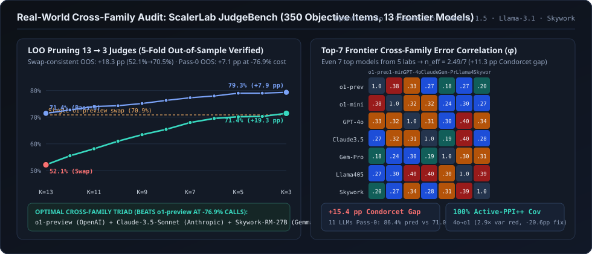

# Real-World Frontier Evaluation: AllenAI RewardBench & ScalerLab JudgeBench

Every benchmark in [`docs/benchmarks.md`](benchmarks.md) tests synthetic controlled regimes with known ground-truth parameters. To verify `cloture` on **real production LLM-as-a-judge traces** across **all 5 major frontier labs/architectures** (OpenAI `o1`/`GPT-4o`, Anthropic `Claude-3.5`, Google `Gemini-1.5`, Meta `Llama-3.1`, and dedicated `Skywork`/`InternLM2` reward models) with **zero synthetic data**, we evaluated `cloture` on two independent public benchmarks:

1. [**AllenAI RewardBench**](https://huggingface.co/datasets/allenai/reward-bench-results) (`2,985` human-verified preference items across `23` subsets, `11` frontier models) — reproduce with `python3 benchmarks/real_world_rewardbench.py` ([`rewardbench_receipts.json`](../benchmarks/rewardbench_receipts.json)).
2. [**ScalerLab JudgeBench**](https://github.com/ScalerLab/JudgeBench) (`350` hard objective-correctness items across MMLU-Pro, LiveBench, and LiveCodeBench, `13` frontier models spanning OpenAI, Anthropic, Google, Meta, and Skywork) — reproduce with `python3 benchmarks/real_world_judgebench.py` ([`judgebench_receipts.json`](../benchmarks/judgebench_receipts.json)).

Both datasets are also loadable in **1 click** inside the zero-install [**`243 KB` Browser WASM Playground**](https://pgg898200-ship-it.github.io/cloture/playground.html) and executable in 15 seconds in [**Google Colab**](https://colab.research.google.com/github/pgg898200-ship-it/cloture/blob/main/examples/cloture_frontier_eval_colab.ipynb).

---

## Executive Summary (Strictly Out-of-Sample Verified)

| Real Public Dataset | Frontier Panel Audited | Effective Votes (`n_eff`) | Condorcet Illusion Gap | Greedy LOO Pruning (In-Sample) | **5-Fold Out-of-Sample CV Gain** | Judge API Cost Saved |
|---|---|---:|---:|---:|---:|---:|
| **AllenAI RewardBench** (`2,985` items, 23 strata) | 7 gen LLMs / 11 frontier models | `2.21 / 7` (`2.73 / 11`) | `+4.65 pp` (`+5.09 pp`) | `92.03% → 95.88%` (**`+3.85 pp`**) | `92.03% → 95.68%` (**`+3.65 pp`**) | **`-72.7%`** (`11 → 3`) |
| **ScalerLab JudgeBench** (Official Swap-Consistent, `350` items) | 11 gen LLMs / 13 frontier models (5 labs) | `3.02 / 11` (`2.49 / 7` top) | `+7.40 pp` (`+11.29 pp` top-7) | `52.14% → 71.43%` (**`+19.29 pp`**) | `52.14% → 70.48%` (**`+18.33 pp`**) | **`-76.9%`** (`13 → 3`) |
| **ScalerLab JudgeBench** (Single-Pass Pass-0, `350` items) | 11 gen LLMs / 13 frontier models (5 labs) | `3.38 / 11` (`3.31 / 13`) | **`+15.36 pp`** (`86.4%` vs `71.0%`) | `71.43% → 79.33%` (**`+7.90 pp`**) | `71.43% → 78.57%` (**`+7.14 pp`**) | **`-76.9%`** (`13 → 3`) |

> **Anti-overfitting guarantee:** In every 5-fold cross-validation split, greedy Leave-One-Out (`loo_delta_acc`) judge selection is performed **strictly on the 80% training folds** and evaluated blind on the held-out 20% test folds. In both benchmarks, the pruned 3-judge cross-family triad outperforms the full ensemble by **`+3.65 pp` to `+18.33 pp` out-of-sample** while cutting API spend by **`72.7%–76.9%`**.

---

# Part 1: AllenAI RewardBench (`2,985` Items, `11` Models, `23` Strata)

## Finding 1.1: 7 Frontier Generative LLM Judges Deliver Only `2.21` Effective Independent Votes

We formed a 7-judge generative panel from three major model families (`OpenAI`, `Google`, `Meta`): `GPT-4o (2024-08)`, `GPT-4o (2024-05)`, `GPT-4o-mini`, `Gemini-1.5-Flash`, `Llama-3.1-405B`, `Llama-3.1-70B`, and `Gemma-2-27B`, stratified across all 23 RewardBench subsets (`2,000` permutations, `2,000` Condorcet sims, `1,000` bootstrap replicates):

| Metric | Measured Value | Interpretation |
|---|---|---|
| **Judges Paid For (`K`)** | `7` | 7 full LLM inference calls per evaluated item |
| **Effective Independent Votes (Kish `n_eff`)** | **`2.21`** (`95% CI [2.11, 2.31]`) | 7 frontier LLMs behave like **2.2 independent judges** |
| **Eigenvalue `n_eff`** | **`2.18`** | Spectral corroboration of severe error concentration |
| **Condorcet Independence Prediction** | `93.66%` | What naive majority-vote math assumes |
| **Actual 7-Judge Panel Accuracy** | **`89.01%`** (`+4.65 pp` illusion gap) | Only `+0.40 pp` over single `GPT-4o` (`88.61%`) at `7×` cost |
| **Within-Family vs. Cross-Family Error Correlation ($\bar{\phi}$)** | **`0.504`** within-family vs. **`0.317`** cross-family | Same-family models fail together (`p = 0.00050`, audited in `67.2 ms`) |

**Top correlated error pairs ($\phi$):**
- `GPT-4o (2024-08)` ↔ `GPT-4o (2024-05)`: **$\phi = 0.587$**
- `GPT-4o (2024-08)` ↔ `GPT-4o-mini`: **$\phi = 0.540$**
- `GPT-4o (2024-05)` ↔ `GPT-4o-mini`: **$\phi = 0.527$**
- `Llama-3.1-405B` ↔ `Llama-3.1-70B`: **$\phi = 0.459$**
- `Gemini-1.5-Flash` ↔ `Gemma-2-27B`: **$\phi = 0.406$**
- Lowest correlation pair: `Gemini-1.5-Flash` ↔ `Llama-3.1-70B` ($\phi = 0.189$).

## Finding 1.2: Pruning 8 of 11 Real Frontier Judges Raises Accuracy `+3.85 pp` (`+3.65 pp` 5-Fold OOS CV) at `-72.7%` Cost

Expanding the panel to **11 real models** (the 7 generative LLMs above + `Skywork-Gemma-27B-RM`, `Skywork-Llama-8B-RM`, `InternLM2-20B-RM`, `Starling-RM-34B`), `cloture.audit_panel` finds `n_eff = 2.73 / 11` (`+5.09 pp` Condorcet gap, `92.03%` panel accuracy — **`-2.94 pp` worse** than the best single judge `Skywork-Gemma-27B-RM` at `94.97%`!).

| Panel Size (`K`) | Panel Accuracy | Condorcet Illusion Gap | Kish `n_eff` | Cost vs. 11-Judge | Next Judge Pruned (LOO Δ Acc) |
|---:|---:|---:|---:|---:|---|
| **`11`** | `92.03%` | `+5.09 pp` | `2.73` | `0.0%` | Drop `GPT-4o-mini` (`+0.64 pp`) |
| `10` | `92.66%` | `+4.55 pp` | `2.80` | `-9.1%` | Drop `Gemma-2-27B` (`+0.54 pp`) |
| `9` | `93.20%` | `+4.37 pp` | `2.74` | `-18.2%` | Drop `GPT-4o (2024-05)` (`+0.23 pp`) |
| `8` | `93.43%` | `+3.80 pp` | `2.79` | `-27.3%` | Drop `Llama-3.1-70B` (`+0.84 pp`) |
| `7` | `94.27%` | `+3.59 pp` | `2.64` | `-36.4%` | Drop `Starling-RM-34B` (`-0.10 pp`) |
| `6` | `94.17%` | `+3.53 pp` | `2.61` | `-45.5%` | Drop `Gemini-1.5-Flash` (`+0.90 pp`) |
| `5` | `95.08%` | `+3.25 pp` | `2.47` | `-54.5%` | Drop `Llama-3.1-405B` (`+0.03 pp`) |
| `4` | `95.11%` | `+2.40 pp` | `2.19` | `-63.6%` | Drop `InternLM2-20B-RM` (`+0.77 pp`) |
| **`3`** | **`95.88%`** | `+2.07 pp` | `1.95` | **`-72.7%`** | **Optimal Triad (`GPT-4o (2024-08)` + `Skywork-Gemma-27B-RM` + `Skywork-Llama-8B-RM`)** |

**Out-of-sample 5-fold CV (`11 → 3`):** `92.03% → 95.68%` (**`+3.65 pp`** across all 5 held-out folds).

## Finding 1.3: Paired `AgentRace` Saves `80.4%` of Real Frontier Evals with `100%` Winner Accuracy

Racing 6 distinct frontier generative models (`GPT-4o (2024-08)`, `Gemini-1.5-Flash`, `Llama-3.1-405B`, `Gemma-2-27B`, `Llama-3.1-70B`, `GPT-4o-mini`) across `50` randomly shuffled permutations of all `2,985` RewardBench items (`delta = 0.05`):
- **Full fixed-N sweep cost:** `17,910` evaluations (`6 × 2,985`) → **`cloture.AgentRace(paired=True)`:** **`3,513.3` evaluations (`80.38%` saved)**, certifying true winner `GPT-4o (2024-08)` on **`50 / 50` (`100.0%`)** runs (`0.0%` wrong winners).

## Finding 1.4: Anytime-Valid `Active-PPI++` Removes `-12.41 pp` Proxy Bias with `10.46×` Variance Reduction

Using raw `GPT-4o-mini` verdicts across all `2,985` items while auditing only `10%` (`~298` items) with `GPT-4o (2024-08)` (`50` shuffled streams, `alpha = 0.05`):
- **Naive `GPT-4o-mini` proxy:** `76.20%` vs. true `88.61%` (**`-12.41 pp` systematic bias**).
- **`cloture.ActivePPI`:** **`100.0%` anytime coverage across all `2,985` sequential steps (`50 / 50`)**, **`10.46×` mean variance reduction**, auditing `90%` fewer frontier calls.

---

# Part 2: ScalerLab JudgeBench (`350` Objective Items, `13` Frontier Models Across 5 Labs)

JudgeBench tests **objective correctness** (MMLU-Pro, LiveBench math/reasoning, LiveCodeBench) where LLM judges struggle significantly more than on stylistic chat preferences. We audited all `13` real models (`o1-preview`, `o1-mini`, `GPT-4o`, `GPT-4o-mini`, `Claude-3.5-Sonnet`, `Claude-3-Haiku`, `Gemini-1.5-Pro`, `Gemini-1.5-Flash`, `Llama-3.1-405B`, `Llama-3.1-70B`, `Llama-3.1-8B`, `Skywork-RM-Gemma-27B`, `Skywork-Critic-70B`) under both JudgeBench's official **Swap-Consistent** protocol (requiring agreement across both `A/B` and `B/A` orderings) and **Single-Pass (Pass-0)**.

## Finding 2.1: Even 7 Top Frontier Models From 5 Different Labs Collapse to `2.49` Effective Votes (`+11.29 pp` Condorcet Gap)

- **Top-7 Cross-Family Panel (`o1-preview`, `o1-mini`, `GPT-4o`, `Claude-3.5-Sonnet`, `Gemini-1.5-Pro`, `Llama-3.1-405B`, `Skywork-RM-Gemma-27B`, Swap-Consistent):**
  - Actual panel accuracy = **`66.57%`** vs. Condorcet prediction **`77.86%`** (**`+11.29 pp` illusion gap**, `p = 0.00050`), Kish **`n_eff = 2.49 / 7`** (`mean_phi = 0.301`).
  - `o1-preview`'s **lowest** error correlations are cross-architecture: `Gemini-1.5-Pro` ($\phi = 0.18$) and `Skywork-RM-Gemma-27B` ($\phi = 0.20$), vs. `o1-mini` ($\phi = 0.38$) and `GPT-4o` ($\phi = 0.33$) within OpenAI.
- **11 Generative Frontier LLMs (Single-Pass Pass-0):**
  - Condorcet independence predicts **`86.36%`** accuracy — actual panel accuracy is only **`71.00%`** (**`+15.36 pp` Condorcet collapse**, `n_eff = 3.38 / 11`, `p = 0.00050`).

## Finding 2.2: Pruning `13 → 3` Lifts Accuracy `+19.29 pp` (`+18.33 pp` 5-Fold OOS CV) and Beats `o1-preview` at `-76.9%` API Cost

- **Official Swap-Consistent (`13 → 3`):**
  - Full 13-model panel: **`52.14%`** (`n_eff = 2.98 / 13`) — **`-18.71 pp` worse** than single `o1-preview` (`70.86%`).
  - Pruned 3-judge cross-family triad (**`o1-preview` (OpenAI) + `Claude-3.5-Sonnet` (Anthropic) + `Skywork-RM-Gemma-27B` (Gemma RM)**): **`71.43%`** (**`+19.29 pp`** over full panel, **`+0.57 pp`** over `o1-preview` alone) at **`-76.9%` fewer judge calls**!
  - **5-Fold Strictly Out-of-Sample CV:** `52.14% → 70.48%` (**`+18.33 pp` out-of-sample gain**).
- **Single-Pass Pass-0 (`13 → 3`):**
  - Full 13-model panel: `71.43%` → Pruned 3-judge triad (`o1-preview` + `o1-mini` + `Skywork-Critic-70B`): **`79.33%`** (`+7.90 pp`, beating `o1-preview` `78.86%`) at **`-76.9%` API cost**!
  - **5-Fold Strictly Out-of-Sample CV:** `71.43% → 78.57%` (**`+7.14 pp` out-of-sample gain**).

## Finding 2.3: Real `Active-PPI++` (`GPT-4o` Proxy → `o1-preview`, 20% Audit) & Paired `AgentRace`

- **`Active-PPI++` (`GPT-4o` cheap proxy → `o1-preview` reasoning judge, 20% audit, `50` shuffled streams):**
  - Naive `GPT-4o` severely underestimates `o1-preview` (`50.29%` vs `70.86%`, **`-20.57 pp` bias**).
  - `cloture.ActivePPI` achieves **`100.0%` anytime coverage across all `350` steps** with **`2.90×` variance reduction**, auditing `80%` fewer `o1-preview` calls.
- **Paired `AgentRace` (Top-6 tight-gap models on `N = 350`):**
  - Eliminates weaker models early to save **`21.6%`** of evals with **`100.0%`** true-winner retention (`0` false eliminations of `o1-preview`).
