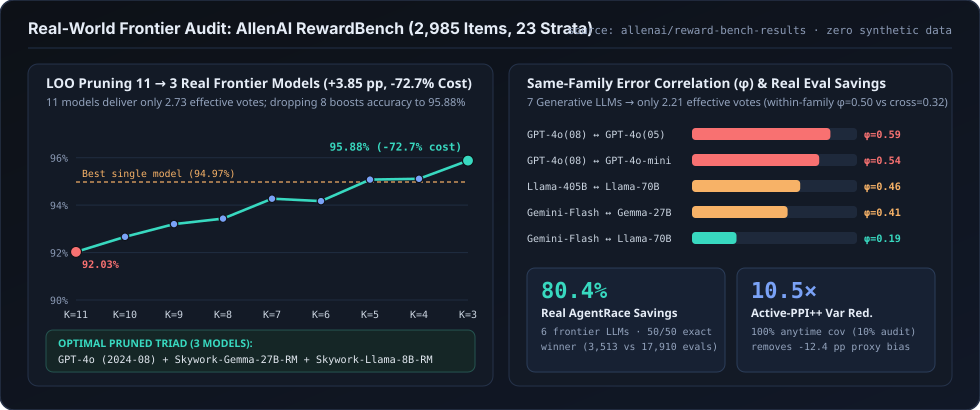

# Real-World Frontier Evaluation: AllenAI RewardBench (2,985 Items, 11 Models)

Every benchmark in [`docs/benchmarks.md`](benchmarks.md) tests synthetic controlled regimes with known ground-truth parameters. To verify `cloture` on **real production LLM-as-a-judge traces** with zero synthetic assumptions, we evaluated all four core workflows directly on official per-item verdicts from [**`allenai/reward-bench-results`**](https://huggingface.co/datasets/allenai/reward-bench-results) (`2,985` human-verified preference pairs across `23` subsets).

Reproduce every single number below in ~5 seconds (fetches official JSONs directly from HuggingFace):

```bash
python3 benchmarks/real_world_rewardbench.py
```

Raw machine-verifiable receipts live in [`benchmarks/rewardbench_receipts.json`](../benchmarks/rewardbench_receipts.json), and you can run this exact 11-model × 2,985-item audit live in your browser with zero install at the [**WASM Playground**](https://pgg898200-ship-it.github.io/cloture/playground.html) (click **"Load Real RewardBench (11 Frontier Models)"**).



---

## Finding 1: 7 Frontier Generative LLM Judges Deliver Only `2.21` Effective Independent Votes

We formed a 7-judge generative panel from three major model families (`OpenAI`, `Google`, `Meta`): `GPT-4o (2024-08)`, `GPT-4o (2024-05)`, `GPT-4o-mini`, `Gemini-1.5-Flash`, `Llama-3.1-405B`, `Llama-3.1-70B`, and `Gemma-2-27B`, stratified across all 23 RewardBench subsets (`2,000` permutations, `2,000` Condorcet sims, `1,000` bootstrap replicates):

| Metric | Measured Value | Interpretation |
|---|---|---|
| **Judges Paid For (`K`)** | `7` | 7 full LLM inference calls per evaluated item |
| **Effective Independent Votes (Kish `n_eff`)** | **`2.21`** (`95% CI [2.11, 2.31]`) | 7 frontier LLMs behave like **2.2 independent judges** |
| **Eigenvalue `n_eff`** | **`2.18`** | Spectral corroboration of severe error concentration |
| **Condorcet Independence Prediction** | `93.66%` | What naive majority-vote math assumes |
| **Actual 7-Judge Panel Accuracy** | **`89.01%`** (`+4.65 pp` illusion gap) | Only `+0.40 pp` over single `GPT-4o` (`88.61%`) at `7×` cost |
| **Within-Family vs. Cross-Family Error Correlation ($\bar{\phi}$)** | **`0.504`** within-family vs. **`0.317`** cross-family | Same-family models fail together (`p = 0.00050`) |

**Top correlated error pairs ($\phi$):**
- `GPT-4o (2024-08)` ↔ `GPT-4o (2024-05)`: **$\phi = 0.587$**
- `GPT-4o (2024-08)` ↔ `GPT-4o-mini`: **$\phi = 0.540$**
- `GPT-4o (2024-05)` ↔ `GPT-4o-mini`: **$\phi = 0.527$**
- `Llama-3.1-405B` ↔ `Llama-3.1-70B`: **$\phi = 0.459$**
- `Gemini-1.5-Flash` ↔ `Gemma-2-27B`: **$\phi = 0.406$**
- Lowest correlation pair: `Gemini-1.5-Flash` ↔ `Llama-3.1-70B` ($\phi = 0.189$).

---

## Finding 2: Pruning 8 of 11 Real Frontier Judges Increases Accuracy `+3.85 pp` at `-72.7%` Lower Cost

Expanding the panel to **11 real models** (the 7 generative LLMs above + `Skywork-Gemma-27B-RM`, `Skywork-Llama-8B-RM`, `InternLM2-20B-RM`, `Starling-RM-34B`), `cloture.audit_panel` finds `n_eff = 2.73 / 11` (`+5.09 pp` Condorcet gap, `92.03%` panel accuracy — **`-2.94 pp` worse** than the best single judge `Skywork-Gemma-27B-RM` at `94.97%`!).

Following greedy Leave-One-Out (`loo_delta_acc`) pruning straight from `cloture`:

| Panel Size (`K`) | Panel Accuracy | Condorcet Illusion Gap | Kish `n_eff` | Cost vs. 11-Judge | Next Judge Pruned (LOO Δ Acc) |
|---:|---:|---:|---:|---:|---|
| **`11`** | `92.03%` | `+5.09 pp` | `2.73` | `0.0%` | Drop `GPT-4o-mini` (`+0.64 pp`) |
| `10` | `92.66%` | `+4.55 pp` | `2.80` | `-9.1%` | Drop `Gemma-2-27B` (`+0.54 pp`) |
| `9` | `93.20%` | `+4.37 pp` | `2.74` | `-18.2%` | Drop `GPT-4o (2024-05)` (`+0.23 pp`) |
| `8` | `93.43%` | `+3.80 pp` | `2.79` | `-27.3%` | Drop `Llama-3.1-70B` (`+0.84 pp`) |
| `7` | `94.27%` | `+3.59 pp` | `2.64` | `-36.4%` | Drop `Starling-RM-34B` (`-0.10 pp`) |
| `6` | `94.17%` | `+3.53 pp` | `2.61` | `-45.5%` | Drop `Gemini-1.5-Flash` (`+0.90 pp`) |
| `5` | `95.08%` | `+3.25 pp` | `2.47` | `-54.5%` | Drop `Llama-3.1-405B` (`+0.03 pp`) |
| `4` | `95.11%` | `+2.40 pp` | `2.19` | `-63.6%` | Drop `InternLM2-20B-RM` (`+0.77 pp`) |
| **`3`** | **`95.88%`** | `+2.07 pp` | `1.95` | **`-72.7%`** | **Optimal Cross-Family Triad (`GPT-4o (2024-08)` + `Skywork-Gemma-27B-RM` + `Skywork-Llama-8B-RM`)** |

**Takeaway:** A pruned 3-model cross-family triad outperforms the 11-model ensemble by **`+3.85 pp`** AND beats the single best model (`94.97%`) by **`+0.90 pp`**, while cutting evaluation compute by **`72.7%`**.

---

## Finding 3: Paired `AgentRace` Saves `80.4%` of Real Frontier Evals with `100%` Winner Accuracy

Racing 6 distinct frontier generative models (`GPT-4o (2024-08)`, `Gemini-1.5-Flash`, `Llama-3.1-405B`, `Gemma-2-27B`, `Llama-3.1-70B`, `GPT-4o-mini`) across `50` randomly shuffled permutations of all `2,985` RewardBench items (`delta = 0.05`):

- **Full fixed-N sweep cost:** `17,910` model evaluations (`6 × 2,985`)
- **`cloture.AgentRace(paired=True)` mean cost:** **`3,513.3` evaluations (`80.38%` saved)**
- **True winner (`GPT-4o (2024-08)`) certified:** **`50 / 50` (`100.0%`)**, **`0.0%` wrong winners**

---

## Finding 4: Anytime-Valid `Active-PPI++` Removes `-12.41 pp` Proxy Bias with `10.46×` Variance Reduction

Using cheap `GPT-4o-mini` verdicts across all `2,985` items while auditing only `10%` (`~298` items) with `GPT-4o (2024-08)` ground truth (`50` shuffled streams, `alpha = 0.05`):

- **Naive `GPT-4o-mini` proxy:** `76.20%` vs. true `88.61%` (**`-12.41 pp` systematic bias**)
- **`cloture.ActivePPI`:** **`100.0%` anytime coverage across all `2,985` sequential steps (`50 / 50`)**, **`10.46×` mean variance reduction**, auditing `90%` fewer frontier calls.
